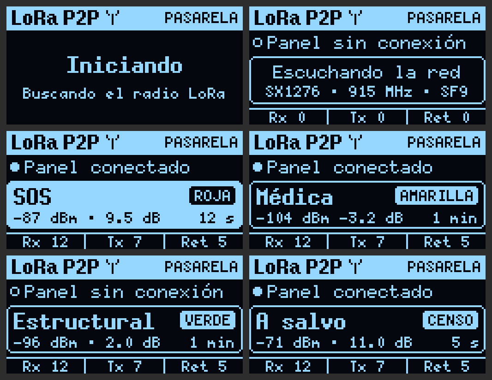

# Firmware del T-Beam — modo pasarela

Firmware para el **LilyGO T-Beam v1.2** (chip de energía **AXP2101**) que lo convierte en la **pasarela** del panel de coordinación: un nodo fijo de la red LoRa conectado por USB a la computadora del puesto de mando.

```
Teléfonos/módems ──LoRa 915 MHz──► T-Beam pasarela ──USB serie──► puente_radio.py ──WebSocket──► panel
```

El modo módem (enlace BLE con el teléfono) todavía no existe.

## Qué hace

- **Enciende el radio:** el AXP2101 debe activar su salida ALDO2, que alimenta el transceptor; si no, el radio no responde. Deja apagado el GNSS (ALDO3), que la pasarela no usa.
- **Detecta el transceptor:** el T-Beam v1.2 se vende con **SX1262 o SX1276**. El firmware prueba los dos al arrancar y lo informa por el puerto serie:
  ```
  # Pasarela lista: SX1262, 915.0 MHz, SF9, BW 125 kHz, CR 4/5, 17 dBm
  ```
- **Recibe:** por cada trama nueva escuchada por radio, escribe una línea `{"hex":"…","rssi":-102,"snr":-3.0}` para el puente.
- **Transmite:** por cada línea `{"hex":"…"}` que llega del puente, transmite esa trama por LoRa.
- **Retransmite como cualquier nodo** (inundación controlada):
  - descarta duplicados por Msg_ID (recuerda los últimos 128 durante 10 min);
  - si la trama llega con TTL > 1, la reenvía con el TTL reducido en uno, tras un retardo aleatorio de 100 a 600 ms;
  - antes de transmitir, escucha el canal; si está ocupado, espera.
- **No interpreta el contenido** (SRS, supuesto S1). El CRC-16 del protocolo lo validan el panel y la app; el firmware solo usa el CRC propio de LoRa para descartar paquetes dañados.
- **Informa su estado:** cada 30 s imprime una línea `# Estado: …` con sus contadores. Las líneas que empiezan con `#` son informativas y el puente las ignora.
- **Muestra su estado en la pantalla OLED** (ver abajo).

## Pantalla

La pantalla OLED de 128×64 sigue la estructura visual de la app móvil:



| Zona | Qué muestra | Equivalente en la app |
|------|-------------|-----------------------|
| Barra superior | «LoRa P2P», antena y el modo («PASARELA») | Barra verde superior |
| Franja de estado | ● Panel conectado / ○ Panel sin conexión | Franja «● Módem conectado» |
| Tarjeta | Última trama escuchada: categoría, chip de prioridad (ROJA, AMARILLA, VERDE, ACUSE, CENSO), RSSI, SNR y antigüedad. Una alerta de prioridad roja invierte la tarjeta durante 30 s | Tarjeta de incidente con «Prioridad ROJA» |
| Barra inferior | Tramas recibidas (Rx), transmitidas (Tx) y retransmitidas (Ret) | Barra de navegación |

- «Panel conectado» depende del **latido** que envía el puente (`{"ping": 1}` cada 10 s) mientras el panel está conectado a él. Si pasan 25 s sin latido, se muestra «Panel sin conexión».
- La categoría se lee del campo Type solo para mostrarla: no cambia cómo se retransmite la trama.
- Por omisión se usa el controlador **SSD1306** (pantalla de 0.96"). Si la tuya es de 1.3" (SH1106) y la imagen se ve recorrida 2 píxeles, agrega `-DPANTALLA_SH1106` a `build_flags` en `platformio.ini`.
- Si la placa no tiene pantalla, el firmware funciona igual sin ella.
- La imagen de arriba se generó compilando `src/pantalla.cpp` en la PC con la misma biblioteca U8g2, no es una foto de la placa.

## Grabar la placa

Necesitas **PlatformIO**: la extensión de VS Code o `pip install platformio`.

1. Conecta el T-Beam por USB con un cable de datos. Si Windows no muestra un puerto `COMx`, instala el driver del chip USB (en la v1.2 suele ser CH9102).
2. **Conecta la antena antes de encender la placa.** Transmitir sin antena puede dañar el radio.
3. Desde esta carpeta:
   ```
   pio run -e pasarela -t upload
   pio device monitor
   ```
   La primera compilación descarga el compilador del ESP32 (varios cientos de MB).
4. En el monitor debe aparecer `# Pasarela lista: …`. Cierra el monitor (Ctrl+C) antes de iniciar el puente: solo un programa puede usar el puerto a la vez.
5. Inicia el puente: ver `PanelCampus/puente_radio/README.md`.

Si aparece `ERROR: no se encontro el transceptor LoRa`, revisa que la placa sea una v1.2 con AXP2101. Las v1.0 y v1.1 usan AXP192 y necesitan otra inicialización de energía.

## Parámetros de radio

Están en `include/config.h`. **Todos los T-Beam de la red deben usar exactamente los mismos valores**: si uno difiere, no se escuchan.

| Parámetro | Valor | Nota |
|-----------|-------|------|
| Frecuencia | 915.0 MHz | Banda ISM 902–928 MHz |
| Ancho de banda | 125 kHz | |
| Factor de dispersión | SF9 | Una alerta de 56 B tarda unos 350 ms en el aire |
| Tasa de código | 4/5 | |
| Palabra de sincronía | privada (0x12) | Compatible entre SX1262 y SX1276 |
| Potencia | 17 dBm | Verificar la normatividad vigente antes de subirla |
| Retransmisión | TTL > 1, retardo de 100 a 600 ms | Debe coincidir con el firmware de los módems |

Son una **propuesta inicial**: la SRS y el SDS aún no los fijan. Conviene confirmarlos con pruebas de alcance en el campus y registrarlos en el SDS.

## Probar sin teléfonos

Con dos T-Beam grabados como pasarela:

1. El primero, con el puente y el panel funcionando.
2. El segundo, conectado a otro puerto USB, con `pio device monitor --echo`. En el monitor pega esta línea, que es una alerta médica válida («Herido») generada con el codec del panel, y pulsa Enter:
   ```
   {"hex":"0BADCAFE1234ABCD05120D929430C2D1EBD06AF3FE9748657269646F0000000000000000000000000000000000000000000000000000BB00"}
   ```
3. El incidente debe aparecer en el tablero del panel, con el RSSI y el SNR del enlace.

Cada trama se acepta una sola vez: el panel y las pasarelas descartan un Msg_ID repetido. Para repetir la prueba usa otra trama, por ejemplo una alerta generada con el simulador de radio (`GET /enviadas` muestra el hexadecimal).
